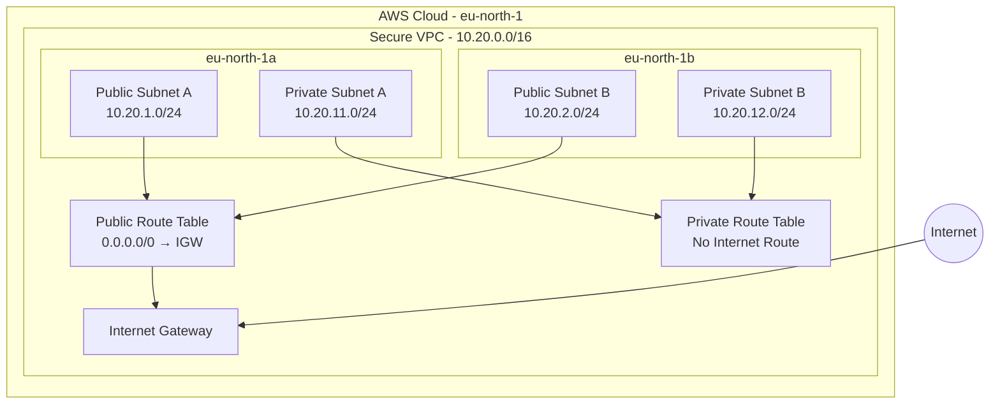

# Secure AWS VPC Architecture

## Project Overview

This project demonstrates the design and infrastructure-as-code implementation of a secure, multi-Availability Zone Virtual Private Cloud (VPC) architecture on Amazon Web Services (AWS), using Terraform.

The architecture separates public and private network segments, provides controlled internet routing through an Internet Gateway, and follows basic network isolation principles.

**Project Status:** Infrastructure configuration completed and locally validated. AWS deployment has not been performed.

## Architecture Overview

The infrastructure is designed in the AWS Stockholm region (`eu-north-1`) across two Availability Zones.

### Network Configuration

| Component | Configuration |
|---|---|
| AWS Region | eu-north-1 |
| VPC CIDR | 10.20.0.0/16 |
| Availability Zones | eu-north-1a, eu-north-1b |
| Public Subnet A | 10.20.1.0/24 |
| Public Subnet B | 10.20.2.0/24 |
| Private Subnet A | 10.20.11.0/24 |
| Private Subnet B | 10.20.12.0/24 |
| Internet Gateway | 1 |
| Public Route Table | 1 |
| Private Route Table | 1 |

### Architecture Diagram



## Security and Network Design Decisions

- **Network segmentation:** Public and private subnets are separated to support different levels of network accessibility.
- **Availability:** Subnets are distributed across two Availability Zones.
- **Internet access:** The public route table directs internet-bound traffic to the Internet Gateway.
- **Private isolation:** The private route table has no internet-bound default route.
- **Public IP assignment:** Automatic public IPv4 assignment is disabled on all subnets.
- **Cost awareness:** NAT Gateway, EC2 instances, load balancers and databases are excluded from the initial design.

**Important:** A public route does not automatically make a workload publicly reachable. Public IP addressing and appropriate security rules are also required.

This is a foundational network architecture, not a complete production security implementation.

## Technologies Used

- Amazon Web Services (AWS)
- Terraform
- HashiCorp Configuration Language (HCL)
- Git and GitHub
- Mermaid

## Project Structure

```text
secure-aws-vpc/
│
├── main.tf
├── providers.tf
├── versions.tf
├── variables.tf
├── outputs.tf
├── terraform.tfvars.example
├── architecture.mmd
├── .gitignore
├── .terraform.lock.hcl
└── README.md
```

## Terraform Validation

The Terraform configuration has been formatted and successfully validated locally.

Commands used:

```powershell
terraform init -backend=false
terraform fmt -recursive
terraform validate
```

No AWS infrastructure has been deployed.

## Cost Considerations

The initial architecture excludes chargeable compute resources and NAT Gateway services.

Although core VPC components such as VPCs, subnets, route tables and Internet Gateways do not carry hourly charges, other AWS charges may apply depending on additional services, public IPv4 usage and data transfer.

Any deployment will require a separate cost review and explicit approval.

## Future Improvements

- Implement security groups and network access controls.
- Introduce a NAT Gateway only if the use case justifies its cost.
- Deploy controlled test workloads.
- Add network monitoring and logging.
- Document operational and security testing.

## Author

Estelle's AWS Solutions Architecture Portfolio Project

Built to demonstrate practical understanding of cloud networking, infrastructure as code, network segmentation and cost-conscious architecture.
